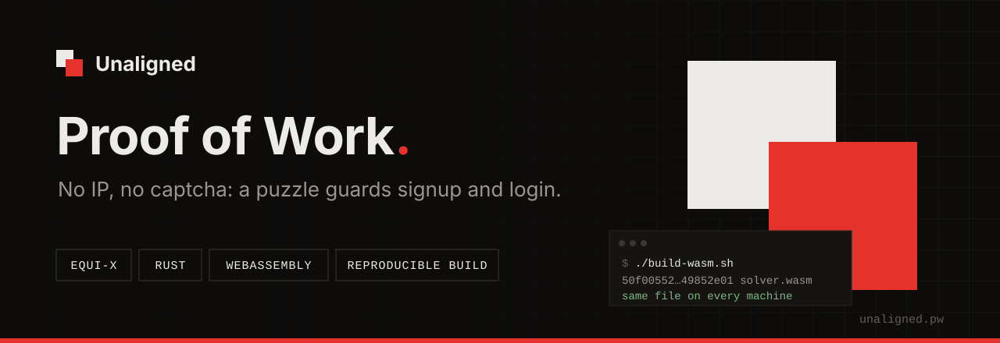
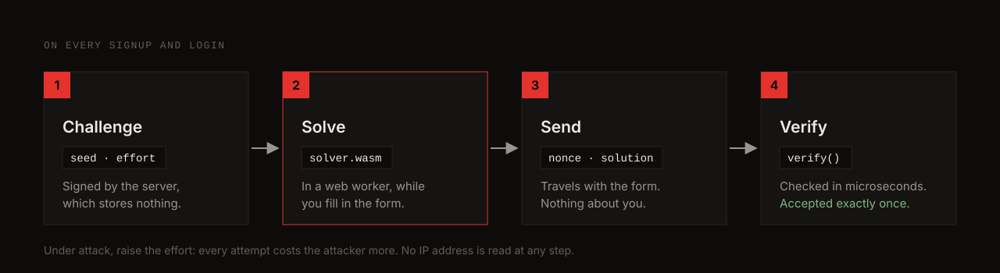

<p align="center">
  
</p>

<p align="center">
  <a href="https://github.com/UnalignedSA/pow/actions/workflows/ci.yml"></a>
  <a href="LICENSE"></a>
  
  
  
</p>

<p align="center">
  <a href="#quick-start">Quick start</a> ·
  <a href="#how-it-works">How it works</a> ·
  <a href="#the-server-side">The server side</a> ·
  <a href="#what-is-here">What is here</a> ·
  <a href="#reproducible-build">Reproducible build</a>
</p>

---

**Unaligned PoW** protects a signup or login form against bots without knowing anything about the visitor.
No IP address, no captcha, no third-party anti-bot service: the browser solves a small puzzle before each
attempt, and your server checks the answer in microseconds.

It is a Rust crate of about 100 lines, the same crate compiled to WebAssembly for the browser, and two
TypeScript files that run it in a web worker. Short enough to read in one sitting, and yours to copy: take
the whole thing, or only the parts you need.

| | |
|---|---|
| **No IP address** | Nothing about the visitor is read, stored or scored. The puzzle is the only gate. |
| **No third party** | No captcha, no fingerprinting script, no external service to trust or to pay. |
| **Fair to browsers** | Equi-X needs memory and per-challenge programs: GPUs and ASICs gain little. |
| **Cheap to check** | Verifying takes microseconds, so fake solutions can't load your server. |

It comes from [Unaligned](https://unaligned.pw), a privacy-first AI API, where the same design guards
signup and login.

## Quick start

**Server**, in Rust. Add the crate:

```toml
[dependencies]
unaligned-pow = { git = "https://github.com/UnalignedSA/pow" }
```

```rust
use unaligned_pow::{verify, NONCE_LEN, SEED_LEN, SOLUTION_LEN};

fn accept(seed: &[u8; SEED_LEN], effort: u32, nonce: &[u8; NONCE_LEN], solution: &[u8; SOLUTION_LEN]) -> bool {
    verify(seed, effort, nonce, solution)
}
```

**Browser.** Copy [`web/`](web) into a [Vite](https://vite.dev) project:

```ts
import { solvePow } from './pow/solve';

// `challenge` comes from your server: { purpose, seed, effort, expires, signature }
const pow = await solvePow(challenge, abortSignal);
// send `pow` with the form: base64 JSON of the challenge, the nonce and the solution
```

Without Vite, replace the `?url` import in `worker.ts` with the URL you serve `solver.wasm` from.

**Native clients** (a CLI, a bot of your own) can call `unaligned_pow::solve` directly. It is faster than
the browser build, because HashX programs are compiled to machine code there.

## How it works

<p align="center">
  
</p>

The puzzle is [Equi-X](https://spec.torproject.org/hspow-spec/v1-equix.html), the one Tor uses to defend
onion services, through the [`equix`](https://crates.io/crates/equix) crate from the Arti project.

- **Solving costs memory and time.** Each challenge runs its own random program, so GPUs and ASICs gain
  little over an ordinary browser.
- **Verifying takes microseconds.** Fake solutions can't be used to load the server.
- **The effort is a number.** The solver tries nonces until an Equi-X solution of
  `PREFIX ‖ seed ‖ nonce ‖ effort` also passes a hash test that succeeds once in `effort` tries. Doubling
  the effort doubles the average work.

The flow:

1. The page asks the server for a challenge: a random 32-byte `seed`, an `effort`, an expiry time and a
   signature over all of it. The server stores nothing.
2. A web worker solves it while the user types. It is usually done before the form is submitted.
3. The form is sent with the challenge, the `nonce` and the `solution`. The server checks its own
   signature, the expiry, the solution, and that this seed was never used before.

## The server side

`verify` only says that the work was done for this seed and effort. The rest is a few lines in your own
server, and it matters as much as the puzzle:

- **Create the seed yourself and sign it** with `effort` and an expiry time (an HMAC is enough), so a
  client can't choose an easy challenge or lower the effort. Nothing needs to be stored when a challenge is
  issued.
- **Refuse expired challenges.**
- **Remember solved seeds until they expire**, so one solution is accepted once.
- **Bind the challenge to its purpose**: a signup solution must not open a login.
- **Raise the effort under load**, as Tor does: count solved challenges per minute and scale the effort
  with it. An attack then makes each attempt more expensive for the attacker, and ordinary visitors only
  wait longer while it lasts.

To give your project its own domain, change `PREFIX` in [`src/lib.rs`](src/lib.rs) and rebuild the solver:
solutions made for another deployment then never verify on yours.

## What is here

| Path | What it is |
| --- | --- |
| [`src/lib.rs`](src/lib.rs) | The crate: `solve` and `verify`, plus the WebAssembly entry points. |
| [`web/solve.ts`](web/solve.ts), [`web/worker.ts`](web/worker.ts) | The browser side: starts a worker, returns the value the form sends. |
| [`web/solver.wasm`](web/solver.wasm) | The crate compiled for the browser, ready to serve. |
| [`build-wasm.sh`](build-wasm.sh) | Rebuilds `web/solver.wasm` and prints its SHA-256. |

## Reproducible build

You need [rustup](https://rustup.rs); the pinned toolchain and the WebAssembly target install themselves.

```sh
git clone https://github.com/UnalignedSA/pow && cd pow
./build-wasm.sh
```

The toolchain is pinned, dependencies are locked and build paths are remapped, so the script produces the
same `web/solver.wasm` on every machine, byte for byte. CI rebuilds it on every change and fails if the
committed file is not what the source builds to: the binary you serve is the source you read.

## Development

```sh
cargo test
cargo fmt && cargo clippy
./build-wasm.sh
```

Pull requests are welcome.

## License

[MIT](LICENSE). Made by [Unaligned](https://unaligned.pw): private AI, pay as you go.
